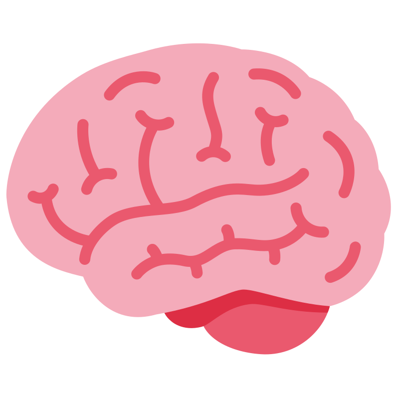

<p align="center">
  
</p>

# Context For Agents is Overrated, Context For Humans is Underrated

Context for Humans is a Chrome extension. It groups the tabs you have open into the projects they belong to, keeps those links after you close the tabs, and answers questions about what you filed.

The original notes are in [idea.md](idea.md).

## Install

1. Open `chrome://extensions`.
2. Turn on Developer mode.
3. Choose Load unpacked and select the `extension` folder.
4. Click the brain icon. The side panel opens.

## API keys

Open **API keys** at the bottom of the side panel.

- **Gemma.** A Google AI Studio key. Grouping, project names, and answers use it.
- **Mem0.** An API key and a user id. Filed links are remembered so you can ask about them after the tabs are closed. Without this key, projects still stay on this computer.

You can also put keys in `extension/.env` and reload the extension. That file is not committed.

```
GEMINI_API_KEY=
MEM0_API_KEY=
SARVAM_API_KEY=
```

`SARVAM_API_KEY` is only read from that file. The side panel mic uses Chrome's speech recognition.

## Group tabs

On **Projects** or **Active tabs**, press **Group my tabs**.

Tabs that already belong to a filed project are grouped under that project's name. Tabs that are not filed yet are sent to Gemma, which suggests a project name and a one-line description. Press **Accept** on a suggestion to file it.

Tabs of the same category are pulled into one Chrome group, including tabs that were sitting between other groups or open in another window. Chrome keeps a group inside one window, so those tabs move to the window that already holds the category.

Blank pages, such as New Tab or an untitled document, go in an **Untitled** group.

## Work on one project

Type a project name, or a sentence such as "I am working on Sunday pasta for dinner", and send it.

Related tabs you open after that join the project's Chrome group, including a tab opened in another window, and the link is filed. Press **Stop**, or say "stop adding tabs", when you are done.

## Ask

Type a question in the box and send it, or click the mic. The first time you talk, Chrome opens a tab so you can allow the microphone. The words you say land in the box and are sent as the question.

The answer uses what you have filed. Click a source to open that page.

## Projects, timeline, and graph

- Click a project name to reopen its links in a group with that name.
- Click a link to open that page.
- **Move** sends a link to another project.
- **Rename** and **Remove** change the filed project. Removing asks you to press **Delete** once more.
- Closing a Chrome tab group does not delete the project. The links stay, and you can reopen them.
- **Timeline** lists what you filed, by week.
- **Graph** draws the same projects and links. Click a node to open it.
